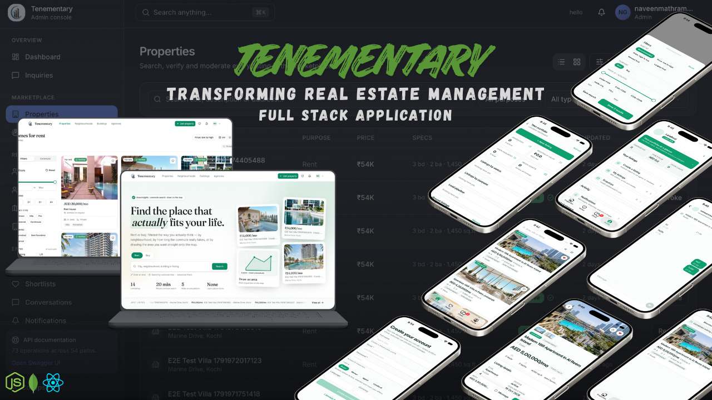
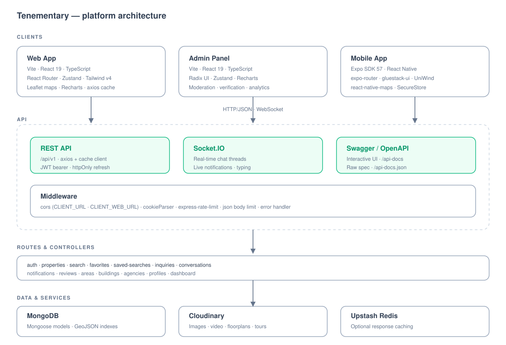

<div align="center">
  <br />
    <a href="https://github.com/NaveenMathramkott/Tenementary-property-finder" target="_blank">
      
    </a>
  <br />

  <div>
    
    
    
    
    
    
    
    
    
  </div>

  <h3 align="center">Tenementary — Real Estate Platform</h3>

  <div align="center">
    A full-stack property finder with a public website, an operations console, and a native mobile app. Listings, map and polygon search, favourites and saved searches, enquiry pipelines, reviews, and real-time chat between renters, buyers, agents and landlords.
  </div>

  <br />

  <div align="center">
    <a href="https://tenementary.vercel.app" target="_blank"><strong>📖 Read the documentation guide →</strong></a>
  </div>
</div>

## <a name="contents">Contents</a>

- [Contents](#contents)
- [Introduction](#introduction)
- [Documentation](#documentation)
- [Repository Layout](#repository-layout)
- [Tech Stack](#tech-stack)
- [Features](#features)
- [Getting Started](#getting-started)
  - [Prerequisites](#prerequisites)
  - [1. Clone the repository](#1-clone-the-repository)
  - [2. Start the API](#2-start-the-api)
  - [3. Start the web app](#3-start-the-web-app)
  - [4. Start the admin panel](#4-start-the-admin-panel)
  - [5. Start the mobile app](#5-start-the-mobile-app)
- [Environment Variables](#environment-variables)
  - [Server — `server/.env`](#server--serverenv)
  - [Web app / admin panel — `client/webApp/.env`, `client/adminPanel/.env`](#web-app--admin-panel--clientwebappenv-clientadminpanelenv)
  - [Mobile app — `client/mobileApp/.env`](#mobile-app--clientmobileappenv)
- [Available Scripts](#available-scripts)
- [API](#api)
    - [Sharing is caring until some find out, Happy Coding 💻](#sharing-is-caring-until-some-find-out-happy-coding-)

## <a name="introduction">Introduction</a>

Tenementary is a full-stack real estate platform built around one Express/MongoDB API that serves three clients:

| Client                                | Stack                        | Purpose                                                                  |
| ------------------------------------- | ---------------------------- | ------------------------------------------------------------------------ |
| **Web app** (`client/webApp`)         | Vite + React 19 + TypeScript | Public listings, search, favourites, saved searches, messages, dashboard |
| **Admin panel** (`client/adminPanel`) | Vite + React 19 + TypeScript | Moderation queues, verification, geo boundaries, analytics               |
| **Mobile app** (`client/mobileApp`)   | Expo SDK 57 + React Native   | Auth-first app with maps, real-time chat and listing management          |

The backend (`server`) is an Express + Mongoose REST API with Socket.IO for real-time chat and notifications, JWT auth with refresh rotation, Cloudinary media uploads, optional Upstash Redis caching, rate limiting, and OpenAPI/Swagger docs.

## <a name="documentation">Documentation</a>

The full platform documentation is published as a React Router docs site:

**🌐 [tenementary.vercel.app](https://tenementary.vercel.app)**

Sections cover the backend, admin panel, web app, and mobile app — architecture, data flow, routes, and endpoints. To run it locally:

```bash
cd storybook
npm install
npm run dev      # http://localhost:5173
npm run build    # static output in build/client
```

The site is deployed to Vercel with `framework: "react-router"`, an immutable 1-year cache on hashed assets, and a 30-day cache on documentation images.

## <a name="repository-layout">Repository Layout</a>

```
Tenementary-property-finder/
├── client/
│   ├── webApp/         # Public web client (Vite + React + TS)
│   ├── mobileApp/      # Expo / React Native client
│   ├── adminPanel/     # Admin operations console (Vite + React + TS)
│   └── serverApiDoc.md # API reference for client developers
├── server/             # Express + Mongoose + Socket.IO API
├── storybook/          # Documentation site (React Router framework mode)
└── project_data/       # Architecture diagram
```

## <a name="tech-stack">Tech Stack</a>

**Backend**

- Node.js, Express 4, ES modules
- MongoDB / Mongoose 8
- Socket.IO 4 (chat + notifications)
- JSON Web Tokens, bcrypt, httpOnly refresh cookies
- Cloudinary (media), Upstash Redis (optional caching)
- express-rate-limit, Swagger UI

**Clients**

- React 19, TypeScript, Vite 8, React Compiler
- Tailwind CSS v4, Radix UI / shadcn-style components, lucide-react
- React Router 7, Zustand 5 (with persisted stores)
- Leaflet / react-leaflet for maps, Recharts for charts
- axios with a caching + request-deduping API client
- Expo SDK 57, React Native 0.86, gluestack-ui v5, UniWind, expo-router
- react-native-maps, expo-secure-store, Socket.IO client

## <a name="features">Features</a>

**Listings & search**

1. Property listings with images, video, floorplans and 360° tour media, blurhash placeholders and ordering
2. Rich filtering — purpose, price range, beds, property type, furnished, amenities, city and radius
3. Drawn-polygon search and commute-time search, with type-ahead suggestions
4. Three search views: list, map, and split, with sorting and pagination
5. Interactive Leaflet maps with custom markers and area/building geo boundaries
6. Price history and similar-property recommendations per listing
7. Reviews and ratings for buildings, areas and agents

**Account & engagement**

8. JWT authentication with OTP login, refresh rotation, and roles: buyer, renter, agent, landlord, admin
9. Favourites / shortlist with optimistic updates
10. Saved searches with off, daily, weekly or instant alerts
11. Inquiry pipeline with new / contacted / closed statuses
12. Real-time chat and notifications over Socket.IO (mobile); polled threads on web
13. Role-aware dashboards with analytics charts

**Operations**

14. Admin queues for users, properties and agencies with one-click verification
15. Geo boundary editing for areas (GeoJSON polygons) and buildings (points)
16. Interactive Swagger UI served from the running API

## <a name="getting-started">Getting Started</a>

### Prerequisites

- Node.js 20+
- MongoDB (local or Atlas)
- A Cloudinary account for media uploads
- Expo Go or an EAS dev build for the mobile app

### 1. Clone the repository

```bash
git clone https://github.com/NaveenMathramkott/Tenementary-property-finder.git
cd Tenementary-property-finder
```

### 2. Start the API

```bash
cd server
npm install
cp .env.example .env   # then fill in the values below
npm start              # http://localhost:4000
```

### 3. Start the web app

```bash
cd client/webApp
npm install
npm run dev            # http://localhost:5173
```

### 4. Start the admin panel

```bash
cd client/adminPanel
npm install
cp .env.example .env
npm run dev            # http://localhost:5174
```

### 5. Start the mobile app

```bash
cd client/mobileApp
npm install
npm start              # Expo dev server
```

> Native maps and other native modules require a development build (`npx expo run:ios` / `run:android`) rather than Expo Go.

## <a name="env">Environment Variables</a>

### Server — `server/.env`

```bash
PORT=4000
NODE_ENV=development
MONGODB_URL=
CLIENT_URL=
CLIENT_WEB_URL=
JWT_SECRET_KEY=
JWT_REFRESH_SECRET_KEY=
JWT_ACCESS_TIME=15m
JWT_REFRESH_TIME=7d
OTP_SECRET_KEY=
CLOUDINARY_CLOUD_NAME=
CLOUDINARY_API_KEY=
CLOUDINARY_API_SECRET=
UPSTASH_REDIS_REST_URL=
UPSTASH_REDIS_REST_TOKEN=
```

`CLIENT_URL` and `CLIENT_WEB_URL` are both used as CORS origins. Redis is optional — endpoints that depend on it return `503 Redis not configured` until it is set.

### Web app / admin panel — `client/webApp/.env`, `client/adminPanel/.env`

```bash
VITE_API_URL=http://localhost:4000/api/v1
VITE_API_DEBUG=true
```

### Mobile app — `client/mobileApp/.env`

```bash
EXPO_PUBLIC_API_URL=http://localhost:4000/api/v1
EXPO_PUBLIC_API_DEBUG=false
```

Leave `EXPO_PUBLIC_API_URL` unset locally to let the app resolve the LAN address from the Metro server automatically.

## <a name="scripts">Available Scripts</a>

| Command             | Where                                             | What it does                  |
| ------------------- | ------------------------------------------------- | ----------------------------- |
| `npm start`         | `server`                                          | Run the API with nodemon      |
| `npm run dev`       | `client/webApp`, `client/adminPanel`              | Vite dev server               |
| `npm run build`     | `client/webApp`, `client/adminPanel`, `storybook` | Production build              |
| `npm run lint`      | all clients                                       | ESLint                        |
| `npm run typecheck` | `client/mobileApp`, `storybook`                   | TypeScript check              |
| `npm start`         | `client/mobileApp`                                | Expo dev server               |
| `npm run dev`       | `storybook`                                       | Documentation site dev server |

## <a name="api">API</a>

All routes are mounted under `/api/v1`. With the server running:

- **Swagger UI** — `http://localhost:4000/api-docs`
- **Raw OpenAPI spec** — `http://localhost:4000/api-docs.json`
- **Health check** — `http://localhost:4000/api/v1/health`

Route groups: `auth`, `properties`, `search`, `favorites`, `saved-searches`, `inquiries`, `conversations`, `notifications`, `reviews`, `areas`, `buildings`, `agencies`, `profiles`, `dashboard`.

**Project architecture**



#### Sharing is caring until some find out, Happy Coding 💻
